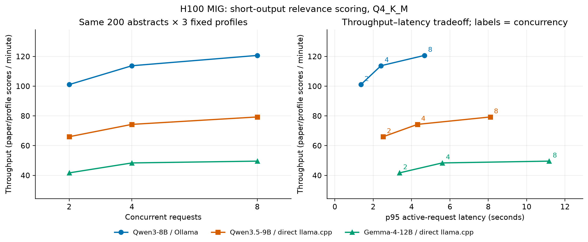

# Medical Feed Concurrency Matrix: 200 Abstracts and Three Interest Profiles

Date: October 31, 2026.

## Scope and completion

This report contains 5,400 independently verified timed requests across 3 model configurations. Each complete model run covers 200 frozen author abstracts, three profiles and requested concurrency 2/4/8: 600 distinct paper/profile inputs and 1,800 timed requests. All three model matrices are complete.

This is independent-abstract relevance scoring, not full-paper summarization. The protocol permits model-upgrade stages only after the Qwen3-8B matrix is complete and independently verified. The experiment measures throughput, latency, GPU-layer offload and output/score stability. There are no independently established relevance gold labels.

## Combined throughput and latency

| Model | Backend | Concurrent requests | Profiles | Timed requests | Paper/profile scores per min | Median latency (s) | p95 latency (s) | Peak sampled memory (MiB) | Output tokens/s |
| --- | --- | ---: | ---: | ---: | ---: | ---: | ---: | ---: | ---: |
| Qwen3-8B | ollama | 2 | 3 | 600 | 101.08 | 1.184 | 1.358 | 6329 | 52.80 |
| Qwen3-8B | ollama | 4 | 3 | 600 | 113.75 | 2.058 | 2.403 | 7455 | 59.17 |
| Qwen3-8B | ollama | 8 | 3 | 600 | 120.69 | 3.931 | 4.668 | 9767 | 62.72 |
| Qwen3.5-9B | llama_cpp | 2 | 3 | 600 | 66.01 | 1.785 | 2.520 | 5445 | 30.08 |
| Qwen3.5-9B | llama_cpp | 4 | 3 | 600 | 74.31 | 3.169 | 4.308 | 5803 | 34.19 |
| Qwen3.5-9B | llama_cpp | 8 | 3 | 600 | 79.29 | 5.849 | 8.102 | 6515 | 36.82 |
| Gemma-4-12B | llama_cpp | 2 | 3 | 600 | 41.69 | 2.831 | 3.370 | 8431 | 28.49 |
| Gemma-4-12B | llama_cpp | 4 | 3 | 600 | 48.38 | 4.891 | 5.595 | 9515 | 33.06 |
| Gemma-4-12B | llama_cpp | 8 | 3 | 600 | 49.58 | 9.647 | 11.165 | 11693 | 33.88 |

Throughput is total completed requests divided by summed timed durations, not a mean of per-round rates. One request scores one paper for one profile; the unit is paper/profile scores per minute, not unique papers already evaluated for all profiles. Each profile contributes the same 200 articles. For example, scoring every candidate for 20 profiles requires 20 requests per candidate in this pointwise design. Latency runs from worker request-path start to receipt of the decoded response, including request preparation, service queuing and inference; it excludes output validation, ledger writing and time an item waits in the upstream dataset before a worker is free. This is a saturated closed-loop load test, not a real-user arrival simulation. Output-token rates depend on each model's tokenizer and do not represent equal amounts of semantic content across models.

## Throughput candidates

Each point aggregates 600 requests. The curve labels are concurrency settings; higher throughput and lower latency are preferable, subject to relevance quality. Both upgraded models use a direct llama.cpp backend; the 8B configuration uses Ollama.

- Qwen3-8B: highest observed throughput at **8 requests**, **120.69 paper/profile scores/minute**, **+19.4%** against its 2-request baseline; p95 latency **4.668 s**. Rates count paper/profile scores. This is a candidate, not an established optimum.
- Qwen3.5-9B: highest observed throughput at **8 requests**, **79.29 paper/profile scores/minute**, **+20.1%** against its 2-request baseline; p95 latency **8.102 s**. Rates count paper/profile scores. This is a candidate, not an established optimum.
- Gemma-4-12B: highest observed throughput at **8 requests**, **49.58 paper/profile scores/minute**, **+18.9%** against its 2-request baseline; p95 latency **11.165 s**. Rates count paper/profile scores. This is a candidate, not an established optimum.

For a latency-aware next validation, concurrency 4 is a reasonable candidate in these configurations:

| Model | Throughput gain: 4 to 8 | p95 latency at 4 (s) | p95 latency at 8 (s) |
| --- | ---: | ---: | ---: |
| Qwen3-8B | +6.1% | 2.403 | 4.668 |
| Qwen3.5-9B | +6.7% | 4.308 | 8.102 |
| Gemma-4-12B | +2.5% | 5.595 | 11.165 |

This is a throughput/latency tradeoff, not a production choice or evidence of improved relevance. No deployment latency target was supplied.

### Illustrative workload arithmetic

The meeting mentioned 10,000 incoming abstracts/day and earlier discussion considered about 20 profiles. These are illustrative workload assumptions, not a verified PubMed arrival rate or a measured deployment requirement. Pointwise scoring would require 200,000 requests. At each configuration's highest observed throughput, the arithmetic is:

| Model | Selected concurrency | Hours for 200,000 scores |
| --- | ---: | ---: |
| Qwen3-8B | 8 | 27.6 |
| Qwen3.5-9B | 8 | 42.0 |
| Gemma-4-12B | 8 | 67.2 |

This is an extrapolation, not a capacity forecast: it assumes unchanged input lengths, profile mix, model behavior, continuous availability and observed service rate. It excludes feed retrieval, summarization and other pipeline work. It motivates testing semantic prefiltering or multiple abstracts per prompt as separate experimental axes.

Selecting an operating point requires a latency target, memory reserve and acceptable relevance quality. A larger configured request count is not a quality improvement or evidence of full GPU utilization. Within-profile concurrency comparisons are controlled for the input workload; comparisons across models include architecture, quantization and template differences.

## Per-profile rounds

| Model | Profile | Concurrent requests | Valid / expected | Scores/min | p95 latency (s) |
| --- | --- | ---: | ---: | ---: | ---: |
| Qwen3-8B | oncology | 2 | 200 / 200 | 100.63 | 1.358 |
| Qwen3-8B | oncology | 4 | 200 / 200 | 114.27 | 2.404 |
| Qwen3-8B | oncology | 8 | 200 / 200 | 116.56 | 5.072 |
| Qwen3-8B | cardiovascular | 2 | 200 / 200 | 99.61 | 1.367 |
| Qwen3-8B | cardiovascular | 4 | 200 / 200 | 109.84 | 2.380 |
| Qwen3-8B | cardiovascular | 8 | 200 / 200 | 119.92 | 4.709 |
| Qwen3-8B | neuroscience | 2 | 200 / 200 | 103.06 | 1.314 |
| Qwen3-8B | neuroscience | 4 | 200 / 200 | 117.39 | 2.398 |
| Qwen3-8B | neuroscience | 8 | 200 / 200 | 125.95 | 4.427 |
| Qwen3.5-9B | oncology | 2 | 200 / 200 | 64.48 | 2.491 |
| Qwen3.5-9B | oncology | 4 | 200 / 200 | 71.37 | 4.383 |
| Qwen3.5-9B | oncology | 8 | 200 / 200 | 80.30 | 8.038 |
| Qwen3.5-9B | cardiovascular | 2 | 200 / 200 | 69.43 | 2.529 |
| Qwen3.5-9B | cardiovascular | 4 | 200 / 200 | 74.27 | 4.371 |
| Qwen3.5-9B | cardiovascular | 8 | 200 / 200 | 74.95 | 8.557 |
| Qwen3.5-9B | neuroscience | 2 | 200 / 200 | 64.36 | 2.471 |
| Qwen3.5-9B | neuroscience | 4 | 200 / 200 | 77.53 | 4.168 |
| Qwen3.5-9B | neuroscience | 8 | 200 / 200 | 83.06 | 7.452 |
| Gemma-4-12B | oncology | 2 | 200 / 200 | 41.64 | 3.421 |
| Gemma-4-12B | oncology | 4 | 200 / 200 | 49.13 | 5.418 |
| Gemma-4-12B | oncology | 8 | 200 / 200 | 48.55 | 11.151 |
| Gemma-4-12B | cardiovascular | 2 | 200 / 200 | 42.01 | 3.217 |
| Gemma-4-12B | cardiovascular | 4 | 200 / 200 | 48.16 | 5.691 |
| Gemma-4-12B | cardiovascular | 8 | 200 / 200 | 48.88 | 11.165 |
| Gemma-4-12B | neuroscience | 2 | 200 / 200 | 41.43 | 3.442 |
| Gemma-4-12B | neuroscience | 4 | 200 / 200 | 47.86 | 5.676 |
| Gemma-4-12B | neuroscience | 8 | 200 / 200 | 51.42 | 11.004 |

Observed input-token ranges, including instructions/profile and source-specific templates:

| Model | Minimum | Maximum |
| --- | ---: | ---: |
| Qwen3-8B | 326 | 840 |
| Qwen3.5-9B | 325 | 843 |
| Gemma-4-12B | 306 | 834 |

## Ordinal-score and ranking stability

Each request returns only the article ID, profile ID and an integer relevance score: 0 unrelated, 1 peripheral, 2 relevant, 3 directly relevant. The table compares each model with its own 2-request outputs. Correlation uses average ranks for ties; no arbitrary article-ID tie-breaking is used to manufacture a top-k ranking. Threshold flips cross the boundary between scores below 2 and scores at least 2.

| Model | Profile | Parallel vs 2 | Exact score agreement | Mean absolute score change | Relevant/not-relevant flips | Spearman (tied ranks) |
| --- | --- | ---: | ---: | ---: | ---: | ---: |
| Qwen3-8B | oncology | 4 | 98.5% | 0.015 | 0 / 200 | 0.9989 |
| Qwen3-8B | oncology | 8 | 98.5% | 0.015 | 0 / 200 | 0.9830 |
| Qwen3-8B | cardiovascular | 4 | 98.0% | 0.020 | 0 / 200 | 0.9832 |
| Qwen3-8B | cardiovascular | 8 | 98.0% | 0.020 | 0 / 200 | 0.9751 |
| Qwen3-8B | neuroscience | 4 | 98.0% | 0.020 | 1 / 200 | 0.9738 |
| Qwen3-8B | neuroscience | 8 | 95.0% | 0.050 | 1 / 200 | 0.9220 |
| Qwen3.5-9B | oncology | 4 | 99.0% | 0.010 | 1 / 200 | 0.9925 |
| Qwen3.5-9B | oncology | 8 | 98.0% | 0.020 | 1 / 200 | 0.9776 |
| Qwen3.5-9B | cardiovascular | 4 | 94.5% | 0.055 | 2 / 200 | 0.8986 |
| Qwen3.5-9B | cardiovascular | 8 | 95.0% | 0.050 | 3 / 200 | 0.9208 |
| Qwen3.5-9B | neuroscience | 4 | 98.5% | 0.015 | 1 / 200 | 0.9883 |
| Qwen3.5-9B | neuroscience | 8 | 98.0% | 0.020 | 0 / 200 | 0.9773 |
| Gemma-4-12B | oncology | 4 | 97.0% | 0.030 | 0 / 200 | 0.9663 |
| Gemma-4-12B | oncology | 8 | 96.5% | 0.035 | 0 / 200 | 0.9597 |
| Gemma-4-12B | cardiovascular | 4 | 98.5% | 0.015 | 1 / 200 | 0.9805 |
| Gemma-4-12B | cardiovascular | 8 | 97.5% | 0.025 | 1 / 200 | 0.9616 |
| Gemma-4-12B | neuroscience | 4 | 97.0% | 0.030 | 3 / 200 | 0.9832 |
| Gemma-4-12B | neuroscience | 8 | 97.5% | 0.025 | 3 / 200 | 0.9904 |

### Score distributions at concurrency 2

| Model | Profile | Score 0 | Score 1 | Score 2 | Score 3 |
| --- | --- | ---: | ---: | ---: | ---: |
| Qwen3-8B | oncology | 106 | 53 | 5 | 36 |
| Qwen3-8B | cardiovascular | 131 | 46 | 14 | 9 |
| Qwen3-8B | neuroscience | 137 | 38 | 14 | 11 |
| Qwen3.5-9B | oncology | 141 | 18 | 6 | 35 |
| Qwen3.5-9B | cardiovascular | 150 | 34 | 7 | 9 |
| Qwen3.5-9B | neuroscience | 157 | 18 | 14 | 11 |
| Gemma-4-12B | oncology | 128 | 33 | 4 | 35 |
| Gemma-4-12B | cardiovascular | 140 | 41 | 8 | 11 |
| Gemma-4-12B | neuroscience | 131 | 36 | 16 | 17 |

Class imbalance can inflate exact agreement; the distributions above are model outputs, not validated class frequencies. A changed score is not necessarily a worse score, and stable scores can still be wrong. There is one measured pass per paper/profile/concurrency cell; this expanded experiment does not separately estimate repeated-run variability at the same concurrency. The three profile orders balance configuration position, but profile-specific workloads are not interchangeable timing repetitions. Claims of improved ranking quality require independently judged relevance and comparison with the actual semantic-ranking baseline.

## Reproducible protocol

- Frozen inputs: all 200 existing abstracts; three synthetic researcher-interest profiles (oncology, cardiovascular medicine, neuroscience), not real-user preference histories; seed-42 article order reused for all configurations and models. This historical collection is not a fresh one-day PubMed feed or a demonstrated daily production workload.
- Profile-specific concurrency order: oncology 2–4–8, cardiovascular 4–8–2, neuroscience 8–2–4.
- Common request options: 4,096-token context, 96-token output cap, temperature 0, seed 42, thinking disabled. The upgraded-model aliases explicitly match the old Qwen effective presence/repetition penalties and top-k/top-p/min-p settings; source-specific templates and stop tokens remain intact.
- Warmup: 2 × concurrency synthetic held-out abstract requests at the target concurrency, excluded from timing. Every timed round starts a fresh private service on loopback port 11437.
- Timings exclude input preparation, standalone preflight tokenization, server startup, model load and warmup. Request-path template rendering/tokenization remains included. They include HTTP handling, queuing, inference, validation and serialized raw-ledger writes. Prefix caching remains enabled.
- Each accepted round must contain exactly 200 unique article/profile records, valid structured scores and normal completion. Failed or interrupted attempts remain stored and are excluded from accepted-round aggregates.
- Independent validation re-parses raw responses, checks input hashes and token budget, recomputes all timing aggregates, verifies full GPU-layer offload and inspects measured overlapping execution slots in backend logs.
- The GPU is the existing H100 MIG/vGPU allocation, not an unrestricted full H100. Compute-utilization telemetry is unavailable; approximately one-second memory samples must not be relabeled as compute utilization. Full transformer-layer offload does not mean every tensor or buffer is GPU-resident; host buffers are preserved in backend memory logs. Other GPU work and changes outside shared-service checks cannot be entirely ruled out.
- Original abstracts are hash-checked after each complete model. Existing summary files are not inputs or outputs of this experiment. Shared Ollama service settings are preserved.

## Model provenance

| Report label | Registered model / source reference | Quantization | Model digest |
| --- | --- | --- | --- |
| Qwen3-8B | `qwen3:8b` | Q4_K_M | `500a1f067a9f782620b40bee6f7b0c89e17ae61f686b92c24933e4ca4b2b8b41` |
| Qwen3.5-9B | `study-qwen35-9b-q4:20261031` | Q4_K_M | `06b156770b19881c72b422487e29562bb0947b1e99701664ecdd6554e3b407b2` |
| Gemma-4-12B | `study-gemma4-12b-q4:20261031` | Q4_K_M | `af0afe213c2a534eefff293f72cc776b9e49cf8f612eb01396f1fe132f2869e8` |

Qwen3.5-9B source checkpoint: `qwen3.5:9b-q4_K_M`, digest `56671c2ab9385f9cfcb404638e32cd62d88e3501d44822208363c010179a3c90`.
Gemma-4-12B source checkpoint: `gemma4:12b-it-q4_K_M`, digest `6114515d63c17436a7c0417d82820ac65ad643e2806c5a3c89cb62846436ed0b`.

Qwen3.5-9B native Ollama 0.34.4 preflight requested two slots but the scheduler forced one for the `qwen35` architecture. That attempt was stopped before timed requests and remains preserved. The successful comparison uses a separately labeled direct llama.cpp backend reading the same checkpoint, with the official pinned HF chat template and tokenizer. Each round checks a representative rendered prompt for exact token-ID parity with the GGUF server; full GPU-layer offload and per-slot context are also checked. No Ollama blocklist or installed binary was patched. Consequently, 8B-versus-9B speed differences combine model and frontend/renderer differences; they do not isolate a model-upgrade effect. The initial failed CPU-discovery probe and corrected context-log parser probe are excluded, as is the eight-request successful smoke test. [Compatibility evidence](compatibility_notes_en.md) records the sequence.

Gemma-4-12B uses the separately labeled direct llama.cpp text-only backend after the original Ollama engine stalled during empty-input initialization, before timed requests. The direct configuration disables that default empty-input warmup and uses the embedded GGUF template/tokenizer with thinking off; common synthetic request warmups are still performed and excluded. All 200 prompts per round are checked for preserved system/user text and context budget. Independent official-HF tokenizer parity was not established for Gemma. The successful workaround changes frontend and text-only initialization together; the precise kernel cause of the original stall was not isolated. This Q4_K_M Gemma run is a new configuration, separate from the teammate historical HF bitsandbytes NF4 full-paper-summary run. These abstract-relevance outputs must not be combined with the historical summary ROUGE/BERTScore or GPT accuracy tables.

## Audit files and remaining work

Dataset SHA-256: `d7167d37541c88eb8f98a36f117821f467174680107990cfccd4b0c63410949a`.

Per-model `analysis.json` contains verified per-profile and combined measurements, engine evidence and the complete score-variation list. Each round retains its model-residency snapshot, server log, warmup responses, timed JSONL responses, GPU samples and status. Source checkpoints, alias settings, inherited model metadata and exact script hashes are preserved.

Next, assess relevance on a preselected independently reviewed sample, inspect concurrency-dependent score changes, and compare final ranking with the identified existing semantic baseline. At a fixed GPU concurrency, test several abstracts per prompt separately, with stable article IDs and cross-batch anchor checks. Only then choose a production configuration. Full-paper summarization needs a separate long-context/long-output benchmark.

Server experiment root: `/data/SFT_demo/Oct/results/feed_matrix_20261031/`.
